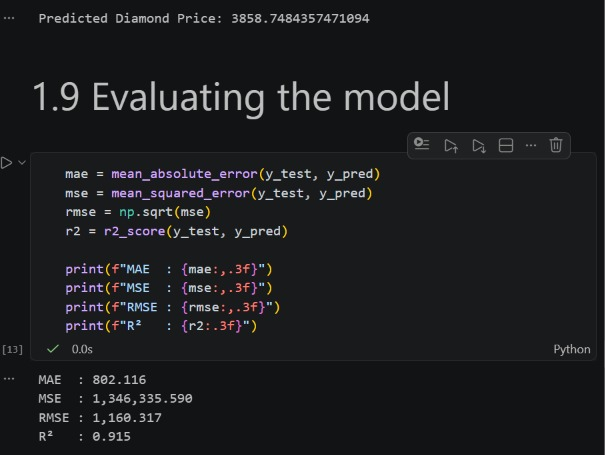
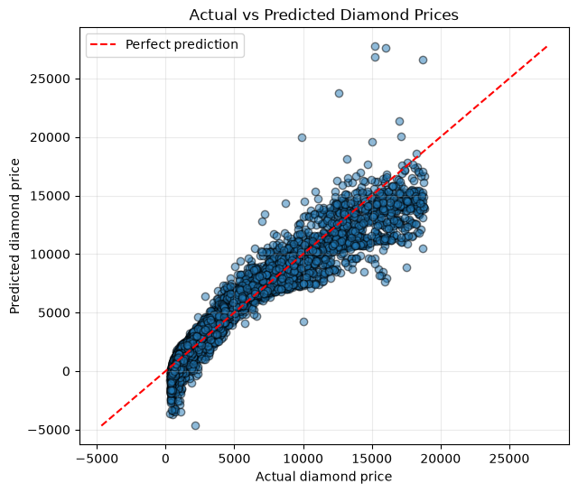

# AI101-team-80-project
# Diamond Price Prediction
Buying a diamond can be confusing, and price depends on several details. In this project, we explore how carat, cut, colour, and clarity relate to a diamond’s price, then use a linear regression model to estimate prices from those features(pandas, matplotlib, scikit-learn).

## Team and roles
| Member | Entry no. | GitHub | Role |
|---|---|---|---|
| Vansh Ahuja | 2026MCB1580 | @Vansh-Ahujaa | Execution lead |
| Bhuwan Garg | 2026AIB1028 | @Bhuwangarg1 | Documentation lead |
| Manthan Aggarwal | 2026AIB1058 | @2026aib1058iit | PPT lead |
| Ganta Kavya Naga Sri | 2026EEB1350 | @GKavyaNS | Video lead |

*All four members contributed code (see commit history).*

## Project structure
```
AI101-team-80-project/
├── data/
│   └── diamonds.csv         # 53,940 diamonds: size, quality, price
├── docs/
│   │── output.png           #Regression plot
│   │── results_scores.jpeg  #Results
│   └── Team80_Diamond_Price_PPT.pdf #PPT
│ 
├── src/
│   └── main.ipynb           # notebook: data → model → results
├── requirements.txt         # libraries and exact versions
└── README.md
```
## Setup

You are advised to follow the instructions given below to run as we have used jupyter notebook in this project for convenience.


You need Python and Git installed. We tested this on Python 3.14.6 on Windows.

Open a terminal (PowerShell on Windows) and type these lines one by one.

**For Windows :**
```
git clone https://github.com/Vansh-Ahujaa/AI101-team-80-project.git
```
```
cd AI101-team-80-project
```
```
python -m venv venv
```
```
venv\Scripts\activate
```
```
python -m pip install --upgrade pip
```
```
python -m pip install -r requirements.txt
```

The first two lines download the project and go into its folder.

 The third line makes a separate Python space for this project (called venv). 
 
 The fourth line switches it on, and you will see `(venv)` at the start of the line.
 
  The last line installs the libraries we used.

If PowerShell says "running scripts is disabled" when you switch on venv, run this line and then run the `venv\Scripts\activate` line again:
```
Set-ExecutionPolicy -Scope Process -ExecutionPolicy RemoteSigned
```

**For Mac / Linux :**
```
git clone https://github.com/Vansh-Ahujaa/AI101-team-80-project.git
```
```
cd AI101-team-80-project
```
```
python3 -m venv venv
```
```
source venv/bin/activate
```
```
python -m pip install --upgrade pip
```
```
python -m pip install -r requirements.txt
```

The setup completed here. Now , you can run the project.

## How to run

1. In the same terminal, with `(venv)` showing, type:
   ```
   python -m notebook
   ```
2. A browser page opens. Click the src folder and then main.ipynb.
3. At the top, click Kernel, then Restart Kernel and Run All Cells.
4. Wait for all the cells to finish. The scores and charts show up at the bottom. They should look like the screenshots in the Expected output section below.


## Expected output



## Links
- Slides (5): [Project PPT](docs/Team80_Diamond_Price_PPT.pdf)
- Video (max 7):[https://drive.google.com/file/d/1KJVTnksQ1SEfHXCrbT5IqCp4jk9koZVc/view?usp=drivesdk](https://drive.google.com/file/d/1KJVTnksQ1SEfHXCrbT5IqCp4jk9koZVc/view?usp=drivesdk)

## AI-use disclosure
- **ChatGpt**- It was used for debugging of the code and to create the first draft of this readme.
- **Claude** - It was used to write and debug setup commands in README.md file. We tested the commands.
- No AI was used to generate the dataset or the results.
